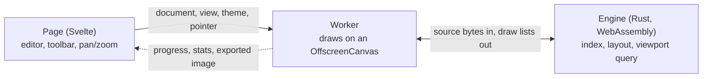

# json2graph

View a JSON document as a graph. Every non-empty object and array is a box, its rows are its values, and an arrow leads from a row to the box of the object or array it holds. Built to stay responsive on files of 100 MB and more.

## Running it

You need Node, pnpm, Rust (`rust-toolchain.toml` names the version and the `wasm32-unknown-unknown` target, and rustup installs them by itself), and [`wasm-pack`](https://rustwasm.github.io/wasm-pack/).

```sh
pnpm install
pnpm wasm   # build the WebAssembly packages; repeat after changing crates/
pnpm dev
```

`pnpm build` builds the WebAssembly packages and then the site, as a Cloudflare Worker with static assets, in `.svelte-kit/cloudflare/`. Set `VITE_SITE_URL` to the address the site is published at (see `.env.example`), so that the page can name its canonical address and the image that link previews show, and so that `sitemap.xml` lists the site.

## Using it

- Edit the JSON on the left: the graph follows once the text is valid again. Format (or Shift+Alt+F in the editor) re-indents it with [Biome](https://biomejs.dev)'s formatter.
- Open a file with the button, or drop one anywhere on the page. Files over 5 MB are shown as a graph only. Example loads a sample document, and Clear empties the editor and the graph.
- Drag to pan, scroll to zoom, or use the buttons over the graph. With the keyboard, once the graph has focus: the arrow keys pan, `+` and `-` zoom, and `0` fits the graph.
- Hover a box to see how the document leads to it: the boxes and arrows from the root to that box stay as they are, with dashes running along the arrows the way they point, and the rest of the graph dims.
- Click a value that ends in `…` to expand it onto wrapped lines; click again to collapse it.
- Export saves a PNG of the whole graph, or of the part on screen when the whole graph would not be readable in one image. Its menu chooses the background (the current one, transparent, or a colour) and whether the grid is kept.
- The sun/moon button switches between light and dark mode.

## How it works



- **`crates/engine/`** indexes the document in one pass without copying it: each value is 16 bytes that point back into the source bytes. It lays the boxes out left to right, and for each frame returns only what the viewport shows, so the cost of a frame depends on the screen, not on the size of the document.
- **`src/lib/graph/worker.ts`** streams the file into the engine's memory, so the document never becomes JavaScript objects, and draws each frame from the engine's buffers.
- **`src/lib/graph/controller.ts`** runs on the page: it hands the canvas to the worker and forwards the canvas size, theme, pointer and the d3-zoom transform.
- **`src/lib/editor/json-editor.ts`** is the CodeMirror editor.
- **`crates/formatter/`** is Biome's JSON formatter, built from a release tag of its repository into a WebAssembly package of its own. It is ten times the size of the engine, so `src/lib/format/` loads it in a second worker only when something is formatted.

## Tests

```sh
pnpm test:engine   # Rust tests, in crates/*/tests/
pnpm test:e2e      # Playwright, against a production build
```

GitHub Actions runs them, with the Vitest tests, on every pull request (`.github/workflows/test.yml`) and before every deployment.

## Deployment

A push to `main` runs the tests and, when they pass, builds the site and deploys it to Cloudflare Workers with `wrangler deploy` (`.github/workflows/deploy.yml`). The repository needs the secrets `CLOUDFLARE_API_TOKEN` and `CLOUDFLARE_ACCOUNT_ID`, and the variable `VITE_SITE_URL`.

Previews of other branches and of pull requests are built by Cloudflare itself, from its connection to the repository. Its build image has no Rust, so the build command to set there is `bash support/cf.sh`, which installs Rust and then runs `pnpm run build`.

`pnpm run deploy` does the same from a machine that is logged in to Cloudflare, without running the tests.

`scripts/generate-json.mjs <megabytes> <file>` writes a large test document.

`scripts/generate-images.mjs` draws the app icons and the link-preview image in `static/` from the logo.
